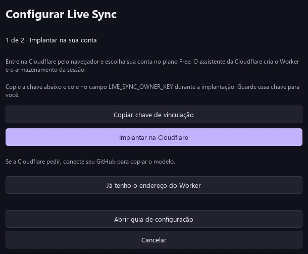
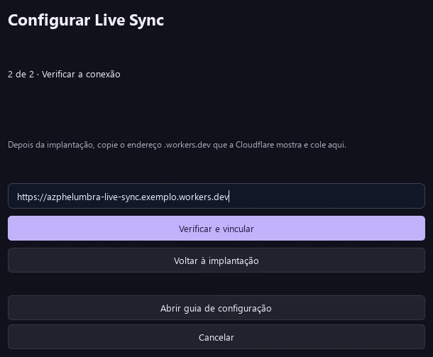

# Live Sync in Azphelumbra

Share Lower Reshanta pins, flight rings, and tactical drawings on the AION 2 map and minimap. The caller publishes each revision from Siege Command. Players receive the strategy through an invite.
Use a version of Azphelumbra that shows **Live Sync** in Siege Command.

## Quick setup for callers

1. Open **Siege Command**, select **Live Sync**, and choose **Host a session (Caller)**.
2. Select **Set up Cloudflare** to generate a pairing key and start deployment in your browser.
3. When Cloudflare finishes, paste the production `.workers.dev` address into Azphelumbra and select **Verify and link**.
4. Select **Create session**, then **Copy invite**, and share the invite with your group.
5. Edit your markers and drawings in Siege Command. When the strategy is ready, return to Live Sync and select **Publish changes**. The panel shows the published version and how many players are connected.

## Illustrated deployment guide

### 1. Copy the key and start deployment

If you need an account, [sign up for Cloudflare](https://dash.cloudflare.com/sign-up), confirm your email, and stay on the **Free** plan. In Azphelumbra, select **Copy pairing key**, then **Deploy to Cloudflare**. Sign in through your browser and choose your own Cloudflare account.

Cloudflare may ask to copy the template to a repository and connect the **Workers Builds** integration. Check the account, repository, and permissions on screen. If offered a choice, give the integration access to the deployment repository only.

Paste the key into `LIVE_SYNC_OWNER_KEY` on Cloudflare and confirm the deployment. The template provisions the Worker and its SQLite-backed Durable Object. Keep the Azphelumbra setup window open while it deploys. [How Deploy to Cloudflare works](https://developers.cloudflare.com/workers/platform/deploy-buttons/).

### 2. Verify the connection

Copy the production HTTPS address ending in `.workers.dev`. Paste it into Azphelumbra and select **Verify and link**. Azphelumbra checks the Worker, pairing key, storage, and synchronization connection. When the panel says **Cloudflare is ready to host**, you can create a session.

For an existing Worker in your account, select **I already have the Worker address** and enter the pairing key you used for that deployment. Keep that key private. Share only the session invite.

## Joining as a player

1. Open **Siege Command → Live Sync → Join a session (Player)**.
2. Paste the full invite and select **Join session**. Players can join without a Cloudflare account.
3. Enable **Reshanta overlay** and enter Lower Reshanta to see the strategy in the game. Use **Select minimap** if you still need to set the minimap area.
4. Press **M** to see the published strategy on the large map. The app receives new published versions automatically.
5. Select **Leave session** to restore your own overlay markers. Personal presets stay on your computer.

The caller can select **End session** to disconnect the group and clear the published strategy from the Worker. The Atlas, local Siege Command, and other modules are available offline.

## Troubleshooting

- **Worker missing or deployment failed.** Wait for deployment to finish. Open the build history in Cloudflare if the production address still does not respond.
- **Invalid address.** Copy the production Worker address ending in `.workers.dev` from Cloudflare.
- **Pairing failed.** Check `LIVE_SYNC_OWNER_KEY` under **Settings → Variables and Secrets**. If you lost the key, generate a new one in Azphelumbra, update the Worker secret, and link the existing address again.
- **Cloudflare asks for a plan or permission.** Check that the account uses Workers Free and your role can deploy Workers. The template uses SQLite-backed Durable Objects, which are available on Free. If you see an upgrade offer, check the selected account, plan, and template first.
- **Invite expired or session ended.** Ask the caller for a fresh invite to an active session.
- **Waiting for the first publication.** The caller must select **Publish changes**.
- **Reconnecting.** The last strategy remains visible. The app fetches the latest revision once it reconnects. If the caller rotated the invite, ask for the new one.
- **Strategy missing in the game.** Confirm that you received a version above zero, are in Lower Reshanta, and have enabled **Reshanta overlay**.
- **Temporary limit or Cloudflare error 1027.** Check account usage. The Workers Free daily limit resets at midnight UTC.

## Free plan limits

In November 2026, Cloudflare documented **100,000 Workers requests** and **100,000 Durable Objects requests per day**. Durable Objects include **13,000 GB-s of daily duration**. SQLite includes **5 million rows read per day, 100,000 rows written per day, and 5 GB of total storage**. Other projects in the same account share those quotas. [Workers limits](https://developers.cloudflare.com/workers/platform/limits/) · [Durable Objects quotas](https://developers.cloudflare.com/durable-objects/platform/pricing/).

A publication to 1,000 connected players can trigger roughly 1,000 snapshot downloads, in addition to connections and status requests. Actual capacity depends on how the service is used. Each strategy has a 512 KiB size limit, and sessions expire after 12 hours.

## Updating or removing the Worker

- **Update.** End active sessions and update the Cloudflare-created repository with the recommended version of `backend/live-sync`. Keep the Worker name, the `LIVE_SYNC_OWNER_KEY` secret, and previous migrations. Verify the new deployment in Cloudflare.
- **Revoke an invite.** Select **Generate new invite**. The old invite loses access, and connected players must rejoin with the new one.
- **Unlink this computer.** End your session and select **Disconnect Cloudflare** to remove the pairing from Windows.
- **Remove the Worker.** End active sessions, open **Workers & Pages**, select your Live Sync Worker, and use **Settings → Delete**. You can then disconnect the repository integration if desired. Invites to that address stop working. [Worker deletion](https://developers.cloudflare.com/workers/wrangler/commands/general/#delete).

The caller owns the Worker and the published strategy resides in that account. Players connect directly to the caller's endpoint.
