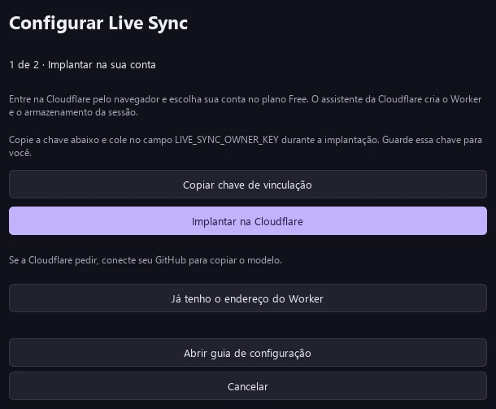
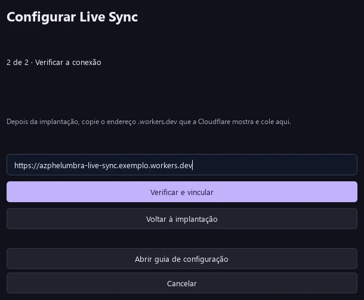

# Live Sync en Azphelumbra

Comparte pines, anillos de vuelo y dibujos tácticos de Lower Reshanta en el mapa y el minimapa de AION 2. El caller publica cada versión desde Siege Command. Los jugadores reciben la estrategia con una invitación.
Usa una versión de Azphelumbra que muestre **Live Sync** en Siege Command.

## Configuración rápida para callers

1. Abre **Siege Command**, selecciona **Live Sync** y elige **Hospedar sesión (Caller)**.
2. Selecciona **Configurar Cloudflare** para generar la clave de vinculación e iniciar la implementación en el navegador.
3. Cuando Cloudflare termine, pega la dirección de producción `.workers.dev` en Azphelumbra y selecciona **Verificar y vincular**.
4. Selecciona **Crear sesión** y luego **Copiar invitación**. Comparte la invitación con el grupo.
5. Edita las marcas y los dibujos en Siege Command. Cuando la estrategia esté lista, regresa a Live Sync y selecciona **Publicar cambios**. El panel indica la versión publicada y cuántos jugadores están conectados.

## Guía ilustrada de implementación

### 1. Copia la clave e inicia la implementación

Si necesitas una cuenta, [regístrate en Cloudflare](https://dash.cloudflare.com/sign-up), confirma tu correo y conserva el plan **Free**. En Azphelumbra, selecciona **Copiar clave de vinculación** y después **Implementar en Cloudflare**. Inicia sesión desde el navegador y selecciona tu cuenta de Cloudflare.

Cloudflare puede pedir permiso para copiar la plantilla a un repositorio y conectar la integración **Workers Builds**. Revisa la cuenta, el repositorio y los permisos que aparecen. Si tienes la opción, concede acceso únicamente al repositorio de esta implementación.

Pega la clave en `LIVE_SYNC_OWNER_KEY` en Cloudflare y confirma. La plantilla prepara el Worker y su Durable Object con SQLite. Mantén abierto el asistente de Azphelumbra mientras termina la implementación. [Cómo funciona Deploy to Cloudflare](https://developers.cloudflare.com/workers/platform/deploy-buttons/).

### 2. Verifica la conexión

Copia la dirección HTTPS de producción que termina en `.workers.dev`. Pégala en Azphelumbra y selecciona **Verificar y vincular**. Azphelumbra verifica el Worker, la clave, el almacenamiento y la conexión de sincronización. Cuando aparezca **Cloudflare está lista para hospedar sesiones**, puedes crear una sesión.

Si ya tienes un Worker en tu cuenta, elige **Ya tengo la dirección del Worker** e ingresa la clave que usaste para esa implementación. Guarda esa clave para ti y comparte solo la invitación de la sesión.

## Cómo unirse como jugador

1. Abre **Siege Command → Live Sync → Unirse a una sesión (Jugador)**.
2. Pega la invitación completa y selecciona **Unirse a la sesión**. Los jugadores pueden entrar sin una cuenta de Cloudflare.
3. Activa el **overlay de Reshanta** y entra a Lower Reshanta. Si falta configurar el área, usa **Seleccionar minimapa**.
4. Presiona **M** para ver la estrategia publicada en el mapa grande. La aplicación recibe automáticamente las nuevas versiones.
5. Selecciona **Salir de la sesión** para recuperar tus marcas en el overlay. Tus ajustes preestablecidos permanecen en tu computadora.

El caller puede seleccionar **Finalizar sesión** para desconectar al grupo y eliminar la estrategia publicada del Worker. El Atlas, Siege Command local y los demás módulos funcionan sin conexión.

## Solución de problemas

- **No se encuentra el Worker o falló la implementación.** Espera a que termine. Si la dirección de producción sigue sin responder, revisa el historial de compilación en Cloudflare.
- **Dirección no válida.** Copia en Cloudflare la dirección de producción del Worker que termina en `.workers.dev`.
- **Falló la vinculación.** Revisa `LIVE_SYNC_OWNER_KEY` en **Settings → Variables and Secrets**. Si perdiste la clave, genera otra en Azphelumbra, actualiza el secreto en el Worker y vincula de nuevo la misma dirección.
- **Cloudflare pide otro plan o permiso.** Verifica que la cuenta use Workers Free y que tu perfil pueda implementar Workers. La plantilla usa Durable Objects con SQLite, disponibles en Free. Si aparece una oferta para subir de plan, revisa la cuenta, el plan y la plantilla.
- **La invitación venció o la sesión finalizó.** Pídele al caller una invitación a una sesión activa.
- **Esperando la primera publicación.** El caller debe seleccionar **Publicar cambios**.
- **Reconectando.** La última estrategia sigue visible. La aplicación busca la versión actual al reconectarse. Si el caller cambió la invitación, pídele la nueva.
- **No veo la estrategia en el juego.** Verifica que la versión recibida sea mayor que cero, que estés en Lower Reshanta y que el overlay de Reshanta esté activo.
- **Límite temporal o error 1027 de Cloudflare.** Consulta el consumo de la cuenta. El límite diario de Workers Free se renueva a medianoche UTC.

## Límites del plan Free

En noviembre de 2026, Cloudflare documentaba **100.000 solicitudes de Workers** y **100.000 solicitudes de Durable Objects por día**. Durable Objects incluye **13.000 GB-s de duración diaria**. SQLite incluye **5 millones de filas leídas por día, 100.000 filas escritas por día y 5 GB de almacenamiento total**. Los demás proyectos de la cuenta comparten las cuotas. [Límites de Workers](https://developers.cloudflare.com/workers/platform/limits/) · [Cuotas de Durable Objects](https://developers.cloudflare.com/durable-objects/platform/pricing/).

Una publicación para 1.000 jugadores conectados puede generar unas 1.000 descargas, además de conexiones y consultas de estado. La capacidad efectiva depende del uso de la cuenta. Cada estrategia admite hasta 512 KiB y las sesiones vencen después de 12 horas.

## Actualizar o eliminar el Worker

- **Actualizar.** Finaliza las sesiones activas y actualiza el repositorio creado por Cloudflare con la versión recomendada de `backend/live-sync`. Conserva el nombre del Worker, el secreto `LIVE_SYNC_OWNER_KEY` y las migraciones previas. Verifica la implementación en Cloudflare.
- **Revocar una invitación.** Selecciona **Generar nueva invitación**. La anterior pierde su acceso y los jugadores deben entrar con la nueva.
- **Desvincular la computadora.** Finaliza la sesión y selecciona **Desconectar Cloudflare** para quitar la vinculación de Windows.
- **Eliminar el Worker.** Finaliza las sesiones, abre **Workers & Pages**, selecciona el Worker de Live Sync y usa **Settings → Delete**. Después puedes desconectar la integración con el repositorio. Las invitaciones de esa dirección dejarán de funcionar. [Cómo eliminar un Worker](https://developers.cloudflare.com/workers/wrangler/commands/general/#delete).

El caller es dueño del Worker y la estrategia publicada reside en su cuenta. Los jugadores se conectan directamente a la dirección del caller.
