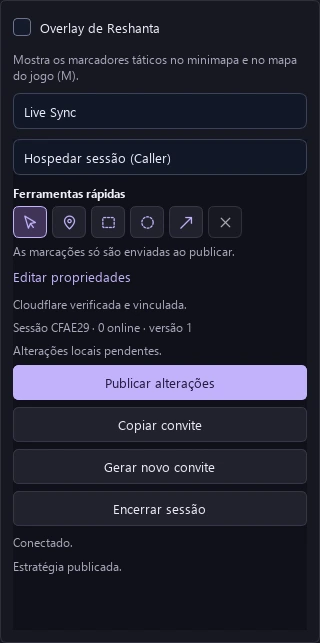
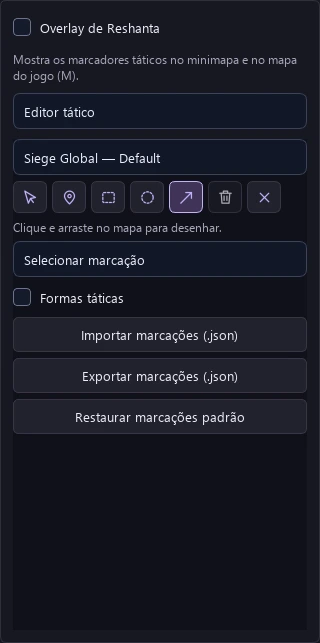
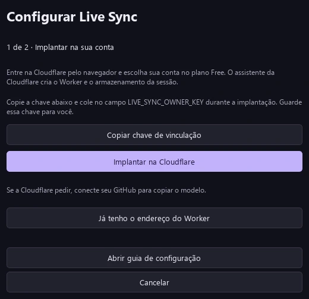
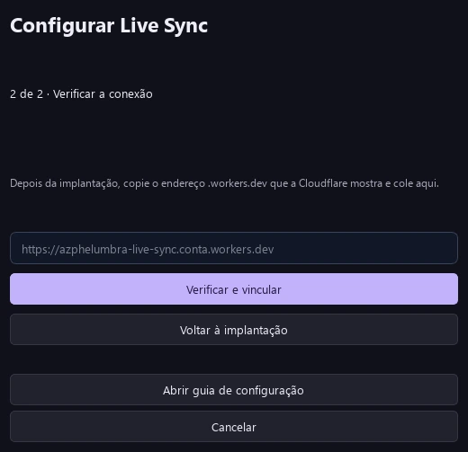
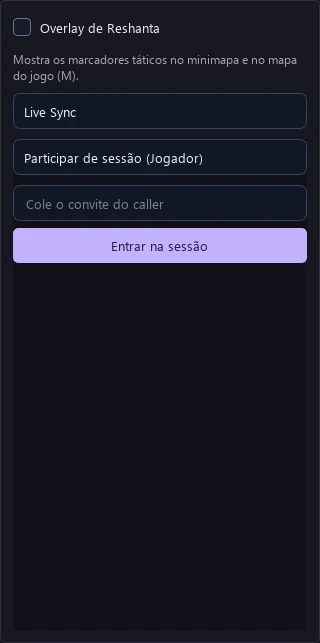

# Live Sync no Azphelumbra

Compartilhe os pins, anéis e desenhos táticos de Lower Reshanta no mapa e no minimapa do AION 2. O caller publica cada versão pelo Siege Command. Os jogadores recebem a estratégia com um convite.
Use a **0.10.0-beta.17** ou uma versão mais recente para acompanhar as telas e usar os atalhos deste guia.

## Configuração rápida para callers

1. Abra **Siege Command**, selecione **Live Sync** e escolha **Hospedar sessão (Caller)**.
2. Clique em **Configurar Cloudflare**. O assistente gera uma chave de vinculação e abre a implantação na Cloudflare.
3. Quando a Cloudflare terminar, cole no assistente o endereço `.workers.dev` e clique em **Verificar e vincular**.
4. Clique em **Criar sessão** e depois em **Copiar convite**. Compartilhe o convite com o grupo.
5. Use as **Ferramentas rápidas** no próprio Live Sync. Escolha o ícone de pin, retângulo, círculo ou seta para marcar o mapa.
6. Clique em **Publicar alterações** quando o plano estiver pronto. Confira a versão publicada e a quantidade de jogadores conectados no mesmo painel.

## Desenhe e publique a estratégia

Clique no mapa para colocar um pin. Para criar uma forma, clique e arraste.
Segure **Shift** para desenhar um quadrado ou círculo. Use **Esc** ou o
ícone **×** para cancelar a ferramenta ativa.

Use **Selecionar e mover** para arrastar uma marcação. Para editar o rótulo,
a cor ou a visibilidade, selecione a marcação e clique em **Editar propriedades**.
O **Editor tático** reúne pins, objetivos e formas no preset ativo. Você também
pode começar por ele e depois publicar pelo Live Sync.

Na **0.10.0-beta.18**, selecione um Flight Ring no mapa ou na lista do
**Editor tático**. Preencha **Nome personalizado** e pressione **Enter**.
Use **Restaurar nome original** para recuperar o código do anel. O nome fica
salvo no preset e chega aos jogadores ao clicar em **Publicar alterações**.
O overlay usa a posição do catálogo local ou de uma calibração publicada.

## Guia ilustrado de implantação

### 1. Copie a chave e abra a implantação

Se você ainda não tem conta, [crie uma conta Cloudflare](https://dash.cloudflare.com/sign-up), confirme seu e-mail e fique no plano **Free**. No Azphelumbra, clique em **Copiar chave de vinculação** e em **Implantar na Cloudflare**. Entre na Cloudflare pelo navegador e selecione sua conta.

A Cloudflare pode pedir autorização para copiar o modelo a um repositório e conectar a integração **Workers Builds**. Confira a conta, o repositório e as permissões exibidas na tela. Quando houver a opção, limite o acesso da integração ao repositório da implantação.

Na tela da Cloudflare, cole a chave no campo `LIVE_SYNC_OWNER_KEY`. Confirme a implantação. O modelo inclui o Worker, o Durable Object e o armazenamento SQLite necessários à sessão. Mantenha o assistente do Azphelumbra aberto enquanto a Cloudflare prepara a infraestrutura. [Como funciona o Deploy to Cloudflare](https://developers.cloudflare.com/workers/platform/deploy-buttons/).

### 2. Verifique a conexão

Quando o Worker estiver implantado, copie o endereço público HTTPS mostrado pela Cloudflare. Cole o endereço que termina em `.workers.dev` e clique em **Verificar e vincular**. O Azphelumbra verifica o Worker, a chave, o armazenamento e a conexão de sincronização. Quando o painel indicar **Cloudflare pronta para hospedar**, você já pode criar a sessão.

Se o Worker já estiver implantado em sua conta, use **Já tenho o endereço do Worker** e informe a chave configurada na implantação anterior. Compartilhe apenas o convite com os jogadores. Guarde a chave de vinculação para você.

## Entrada em sessões para jogadores

1. Abra **Siege Command → Live Sync → Participar de sessão (Jogador)**.
2. Cole o convite inteiro que o caller enviou e clique em **Entrar na sessão**. Uma conta Cloudflare é necessária apenas para o caller.
3. Para ver o plano no mapa e no minimapa do jogo, ative **Overlay de Reshanta** e entre em Lower Reshanta. Se precisar, use **Selecionar minimapa** para configurar a área que o app acompanha.
4. Abra o mapa do jogo com **M** para ver a estratégia no mapa grande. O aplicativo acompanha cada nova publicação.
5. Use **Sair da sessão** para voltar aos seus pins no overlay. Os presets pessoais ficam salvos no computador.

Use **Encerrar sessão** no painel do caller para desconectar o grupo e descartar a estratégia publicada no Worker. O Atlas, o Siege Command local e os outros módulos continuam disponíveis offline.

## Solução de problemas

- **O endereço ainda não responde como Live Sync.** Aguarde o término da implantação e copie o endereço HTTPS de produção do Worker. Se a Cloudflare criou apenas um projeto de exemplo ou a compilação falhou, veja o histórico de implantação no painel.
- **Endereço inválido.** Cole o endereço de produção terminado em `.workers.dev` que aparece no painel do Worker.
- **A implantação pede um plano ou permissão.** Confira se a conta escolhida usa Workers Free e se seu perfil tem permissão para implantar Workers. O modelo usa Durable Objects com SQLite, compatíveis com o Free. Se aparecer uma oferta de upgrade, volte e confira o plano, a conta e o modelo selecionados.
- **A chave está ausente ou é diferente.** Confira `LIVE_SYNC_OWNER_KEY` em **Settings → Variables and Secrets** no Worker. Se você perdeu a chave, abra uma nova configuração no Azphelumbra, copie a nova chave, atualize o segredo no Worker e vincule pelo endereço existente.
- **O canal de sincronização está indisponível.** Confira se a implantação terminou. Experimente outra conexão para verificar se a rede permite WebSockets seguros.
- **Aguardando a primeira publicação.** O caller precisa clicar em **Publicar alterações**. As edições locais ficam pendentes até esse clique.
- **Reconectando.** O app mantém a última estratégia recebida enquanto tenta reconectar. Ao recuperar a conexão, ele consulta a versão atual. Se o caller gerou um novo convite, peça esse convite para entrar de novo.
- **Convite expirado ou sessão encerrada.** Peça ao caller um convite de uma sessão ativa.
- **A estratégia não aparece no jogo.** Confira se a versão recebida é maior que zero, se você está em Lower Reshanta e se **Overlay de Reshanta** está ativo. O app reutiliza a região e a calibração do overlay atual.
- **Limite temporário ou erro 1027 da Cloudflare.** Aguarde e confira o uso da conta. Se o limite diário do Workers Free foi atingido, ele é renovado à meia-noite UTC.

## Limites do plano Free

Na consulta de novembro de 2026, a Cloudflare documentava **100 mil solicitações de Workers por dia** e **100 mil solicitações de Durable Objects por dia**. A cota diária de duração dos Durable Objects era de **13 mil GB-s**. Para SQLite, o plano incluía **5 milhões de linhas lidas e 100 mil linhas gravadas por dia**, com **5 GB** de armazenamento total. As cotas são da conta. Outros projetos na mesma conta podem consumir parte delas. [Limites do Workers](https://developers.cloudflare.com/workers/platform/limits/) · [Cotas de Durable Objects](https://developers.cloudflare.com/durable-objects/platform/pricing/).

Como referência, uma publicação para 1.000 jogadores conectados pode gerar aproximadamente 1.000 downloads individuais, além de conexões, reconexões e pedidos de status. A capacidade efetiva depende do uso e do ambiente. O app limita cada estratégia a 512 KiB e encerra sessões após 12 horas.

## Atualizar ou remover a infraestrutura

- **Atualizar.** Encerre as sessões abertas e aplique a versão recomendada do conteúdo de `backend/live-sync` ao repositório criado pela Cloudflare. Confirme a nova implantação no painel. Preserve o nome do Worker, o segredo `LIVE_SYNC_OWNER_KEY` e as migrações anteriores para manter o endereço de vinculação.
- **Revogar um convite.** Clique em **Gerar novo convite**. O antigo perde o acesso e os jogadores conectados terão de entrar com o novo convite.
- **Desvincular este computador.** Clique em **Encerrar sessão** e depois **Desconectar Cloudflare**. A vinculação salva é removida do Windows.
- **Remover o Worker.** Encerre as sessões. No painel Cloudflare, abra **Workers & Pages**, selecione o Worker do Live Sync e use **Settings → Delete**. Confira se o recurso removido é o da sua sessão. Se quiser, desconecte a integração com o repositório criado para o modelo. Excluir a implantação interrompe os convites desse endereço. [Configuração do Worker](https://developers.cloudflare.com/workers/wrangler/commands/#delete).

O Worker pertence à conta do caller. A senha da Cloudflare é usada na página oficial no navegador. O Azphelumbra guarda apenas a vinculação no Windows e os convites dão acesso de leitura à sessão.

## Reporte problemas

Informe a versão do Azphelumbra, a versão do Windows, o sintoma, quantos participantes havia e como reproduzir. Remova chaves, tokens, convites privados e dados pessoais antes de anexar logs ou capturas. [GitHub Issues](https://github.com/jpgalvao-architect/strigoi-aether-map/issues/new).
